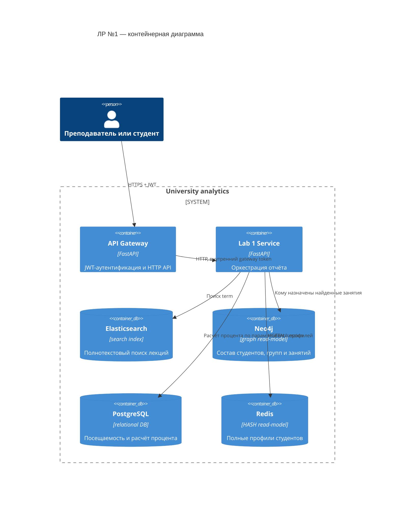
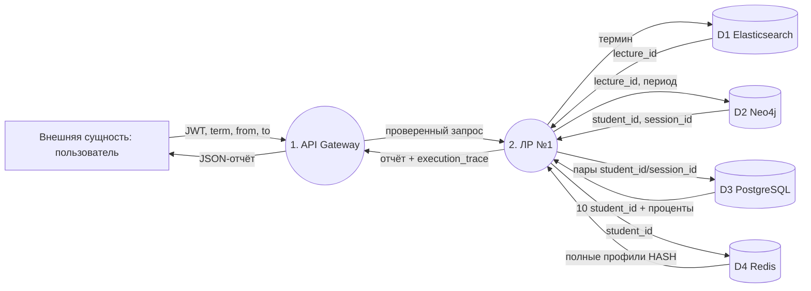

# ЛР №1: сервис аналитического отчёта

## Назначение

`GET /api/v1/lab1/report` возвращает десять студентов с минимальной
посещаемостью лекций, найденных по фразе, за заданный период. В HTTP-ответе
остаются только имя, фамилия и процент; диагностическая трасса четырёх
хранилищ записывается в `Logs/lab1_pipeline.log`. Метод доступен только с
JWT Bearer-токеном.

## C4: контейнерная диаграмма



## DFD Йордана–Кода



## Обоснование хранилищ

1. **Elasticsearch** ищет термин в `title`, `annotation`, `content_text` и
   возвращает `lecture_id`. Это полнотекстовая задача с русским анализатором.
2. **Neo4j** одним обходом графа получает пары `student_id`–`session_id`:
   студент состоит в группе, а занятие назначено этой группе и входит в период.
   Это определяет, кто **должен был** быть на найденных лекциях.
3. **PostgreSQL** по полученным парам и таблице `attendance` считает только
   критерий ранжирования: UUID студента, количество плановых и посещённых
   занятий, процент. Поля профиля студента здесь не выбираются.
4. **Redis** хранит денормализованный `students_cache:<uuid>` HASH: студент,
   группа, специальность, организационный путь и курсы. Он возвращает полную
   информацию по десяти UUID без повторения большого JOIN из PostgreSQL.

## Подготовка и тест

Сначала нужно подготовить read-models исходным скриптом:

```powershell
python uni_python_fixed_2.py postgres
python uni_python_fixed_2.py redis
python uni_python_fixed_2.py neo4j
python uni_python_fixed_2.py elasticsearch
```

Запуск контейнеров:

```powershell
docker compose -f docker-compose.lab1.yml up --build
```

Gateway доступен на `http://localhost:8088` по умолчанию. Порт можно изменить
без редактирования Compose-файла, например `GATEWAY_PORT=8080 docker compose
-f docker-compose.lab1.yml up --build`. Сначала проверьте, что отвечает именно
этот Gateway:

```powershell
curl http://localhost:8088/health
```

Ожидаемый результат: `{"status":"ok","service":"university-api-gateway"}`.

Получение JWT:

```powershell
curl -X POST "http://localhost:8088/auth/token?username=teacher&password=teacher-secret"
```

Запрос отчёта:

```powershell
curl "http://localhost:8088/api/v1/lab1/report?term=база%20данных&from=2026-02-09&to=2026-03-22" -H "Authorization: Bearer <JWT>"
```

В поле `execution_trace` ответа видны результаты всех трёх стадий: найденные
лекции, десять UUID с процентами и число профилей, полученных из Redis.
